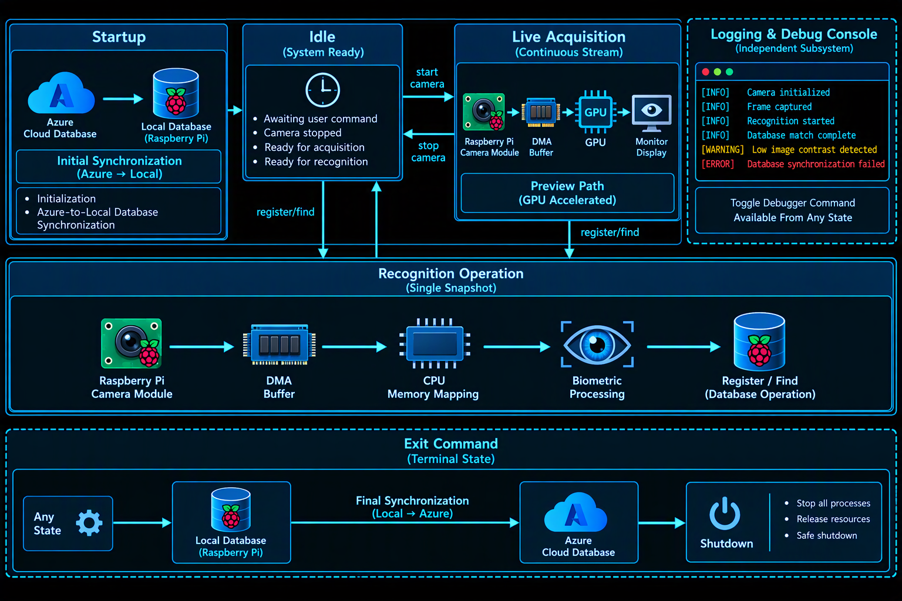

# Eye Scan - System Architecture

## Overview
The **Eye Scan** application is an embedded iris recognition system designed for deployment on **Raspberry Pi** hardware. The architecture follows a state-driven workflow that separates system initialization, image acquisition, biometric processing, database management, and shutdown procedures into well-defined operational stages.

## Architecture
The following diagram illustrates the high-level system workflow and interaction between acquisition, processing, synchronization, and control subsystems.

During startup, the system initializes all required components and synchronizes biometric records from the **Azure** cloud database to the local database. Once initialized, the application enters an idle state where it awaits user commands and coordinates transitions between acquisition and recognition operations.

The architecture supports two primary execution paths. The first path provides **GPU**-accelerated live image acquisition, enabling continuous camera preview with minimal **CPU** overhead. The second path performs biometric registration and identification through a single-image processing pipeline, where captured frames are transferred from the camera subsystem to the recognition engine for template generation and database matching.

A local-first database design is used throughout the system. All recognition and enrollment operations are performed against the local database, while cloud synchronization ensures consistency between the embedded device and the remote **Azure** repository.

An independent logging and debugging subsystem operates alongside all application states, providing runtime diagnostics and monitoring capabilities without interfering with the primary recognition workflow.

Before shutdown, the system performs a final synchronization of locally modified records with the cloud database, ensuring data consistency and preserving newly enrolled biometric templates.

## Next Steps
For a more in-depth look into the hardware components, see the [Hardware Components](HARDWARE.md).

For general project information, see the [README](../README.md).
