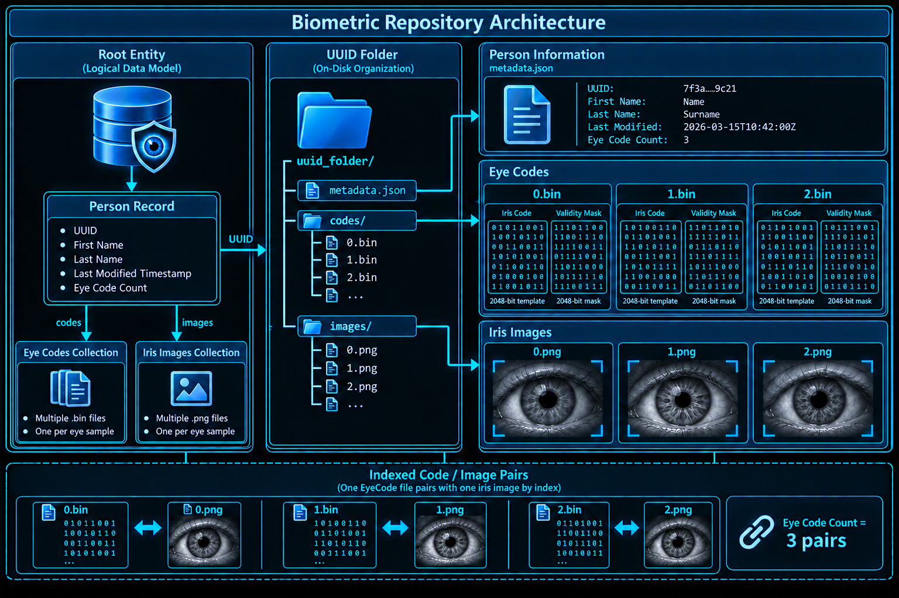

# Eye Scan - Database Infrastructure

## Overview
**Eye Scan** employs a synchronized local-first database architecture that combines the performance of local storage with the consistency of centralized cloud persistence.

At application startup, the biometric repository is synchronized from the cloud to the local device, ensuring that the latest available biometric records are accessible before any enrollment or recognition operations begin. During runtime, all operations are performed exclusively against the local repository, allowing the system to operate with minimal latency and without continuous network connectivity.

When the application terminates normally, any repository modifications are synchronized back to the cloud, ensuring that newly enrolled subjects, updated metadata, iris templates, and captured images are persisted and made available to other devices within the deployment.



## Repository Architecture
The repository is organized around a person-centric storage model where every enrolled individual is represented by a unique **UUID (Universally Unique Identifier)**. The **UUID** serves as the primary identifier throughout the system and maps directly to a dedicated folder within the repository.

Each person record consists of:
- Personal metadata
- One or more iris code
- Corresponding source iris images

This structure provides a clear relationship between the logical database model and its physical representation on disk.

## Directory Structure
Each enrolled person is stored within an isolated repository directory:

```text
repository/
└── <uuid>/
    ├── metadata.json
    ├── codes/
    │   ├── 0.bin
    │   ├── 1.bin
    │   ├── 2.bin
    │   └── ...
    └── images/
        ├── 0.png
        ├── 1.png
        ├── 2.png
        └── ...
```
The repository structure is intentionally filesystem-based, making inspection, backup, replication, and synchronization straightforward while eliminating dependency on external database servers.

### Person Metadata
Every **UUID** directory contains a **metadata.json** file describing the enrolled subject. Typical metadata fields include:

```json
{
  "id": "7f3a...9c21",
  "firstName": "Name",
  "lastName": "Surname",
  "modifiedAt": "2026-03-15T10:42:00Z",
  "count": 3
}
```
The metadata file provides a lightweight method of loading repository information without requiring biometric template data to be read into memory.

### Iris Code - Image Pairs
Biometric iris templates are stored within the codes directory as binary files.

```text
codes/
├── 0.bin
├── 1.bin
├── 2.bin
└── ...
```
Each file contains:
- Iris feature template
- Validity mask

Multiple templates may be associated with a single person, allowing the system to maintain several high-quality biometric samples captured under different conditions, which enhances recognition accuracy and robustness.

Original iris images are stored within the images directory.

```text
images/
├── 0.png
├── 1.png
├── 2.png
└── ...
```
Each iris template corresponds directly to the image with the same index.

This convention guarantees full traceability from a generated biometric template back to its originating iris image while simplifying repository management and synchronization.

The total number of template-image pairs is recorded within **metadata.json**.

## Next Steps
For details on testing and validation methods used in this system, see [Testing & Validation](TESTING.md).

For a more in-depth look into the hardware components, see the [Hardware Components](HARDWARE.md).
