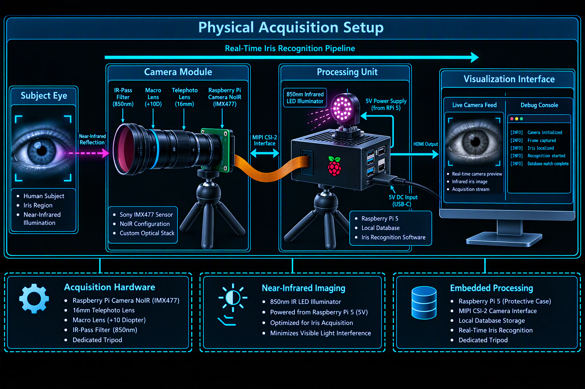
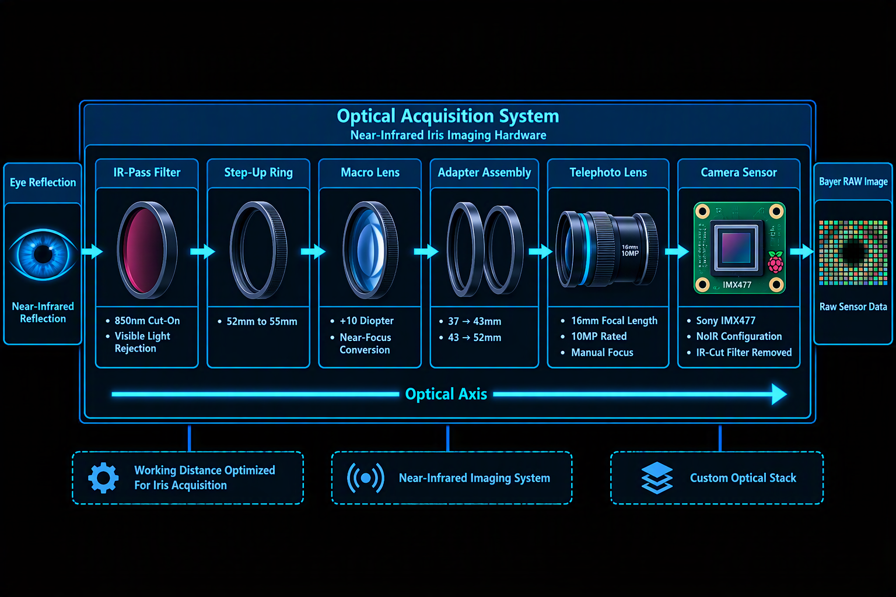

# Eye Scan - Hardware Components

## Overview
The **Eye Scan** platform is built around a custom near-infrared imaging system designed for iris acquisition on **Raspberry Pi** hardware. The acquisition setup combines specialized optics, infrared illumination, embedded processing, and custom acquisition drivers to produce high-quality iris images suitable for biometric recognition.

The hardware architecture consists of three major subsystems:
- Optical Acquisition System
- Embedded Processing Platform
- Near-Infrared Illumination System

Together, these components provide a complete imaging pipeline, from infrared light reflection at the human eye to image acquisition, processing, and visualization.

## Physical Acquisition Setup

The physical acquisition system illustrates the complete data path used during iris recognition. Near-infrared light is projected towards the subject's eye and reflected back through the custom optical stack before being captured by the camera sensor. The acquired image is transferred to the **Raspberry Pi** processing platform using the **MIPI CSI-2** interface, where recognition and database operations are performed.

The visualization interface provides a live acquisition preview together with diagnostic information generated by the application.

## Optical Acquisition System
The optical acquisition system was specifically designed for short-range iris imaging. A custom optical stack is mounted in front of the camera sensor to improve iris visibility while suppressing unwanted visible-light interference.

The incoming optical path consists of:

1. IR-Pass Filter
2. Step-Up Ring
3. Macro Lens
4. Adapter Assembly
5. Telephoto Lens
6. Camera Sensor

The resulting configuration enables stable iris acquisition at an optimized working distance while maintaining sufficient image detail for subsequent biometric processing.

## Hardware Components

### Raspberry Pi 5
The **Raspberry Pi 5** serves as the primary processing unit of the system. It hosts the acquisition software, biometric processing pipeline, local database, user interface, and synchronization services. All recognition and enrollment operations are executed locally on the device.

### Raspberry Pi HQ Camera Module NoIR (Sony IMX477)
The camera subsystem is responsible for image acquisition. The **Sony IMX477** image sensor operates in a NoIR configuration, allowing sensitivity to near-infrared wavelengths by removing the standard IR-cut filter. The sensor captures **Bayer RAW** images that are subsequently processed by the acquisition pipeline.

### 16 mm Telephoto Lens
The telephoto lens provides the primary image magnification required for iris imaging. Its focal length allows the camera to capture the iris from a practical working distance while maintaining sufficient spatial resolution.

### +10 Diopter Macro Lens
The macro lens modifies the focal characteristics of the optical system, enabling sharp focus at close acquisition distances. This component is essential for obtaining detailed iris texture information.

### Step-Up Rings and Adapter Assembly
The optical adapters mechanically integrate the filter and lens components into a single optical stack. They ensure correct alignment between the camera module and optical elements.

### IR-Pass Filter (850 nm)
The **IR-pass filter** suppresses visible light while allowing near-infrared wavelengths to reach the sensor. This improves image consistency and reduces the influence of ambient lighting conditions.

### 850 nm Infrared LED Illuminator
The infrared illuminator provides controlled near-infrared illumination of the eye. Since iris texture is highly visible under infrared light, the illuminator improves image quality while minimizing interference from visible-light reflections.

### Display Interface
The display subsystem provides live camera visualization, image preview, and diagnostic output generated by the application. It is primarily used during acquisition, testing, and debugging.

### Dedicated Tripod Mounts
Tripods are used to stabilize both the acquisition unit and illumination system. Stable positioning improves repeatability and reduces motion-related image degradation.

## Acquisition Infrastructure
Although primarily implemented in software, several acquisition components operate closely with the hardware platform and are considered part of the overall acquisition infrastructure.

### Camera Driver
The Camera Driver is responsible for configuring and controlling the **Raspberry Pi HQ Camera Module** throughout the acquisition process. It manages camera initialization, sensor parameter configuration, image capture requests, exposure settings, frame timing, and communication with the imaging hardware through the **MIPI CSI-2** interface.

The driver produces **Bayer RAW** image frames and exposes a unified acquisition interface to higher-level application components. It also coordinates the allocation of **DMA**-backed image buffers, enabling captured frames to be transferred through the acquisition pipeline with minimal latency and without unnecessary intermediate copies.

### DMA Driver
he **DMA** acquisition layer provides a zero-copy image transfer pipeline between the camera subsystem and the processing platform. During live acquisition, captured image buffers remain in kernel-managed memory and are transferred directly to the **GPU** for hardware-accelerated rendering, bypassing the **CPU** entirely. This allows continuous camera preview with minimal processing overhead.

When biometric processing is required, the same **DMA**-backed buffers are mapped into the application's virtual address space, allowing the **CPU** to access image data without performing additional memory copies. As a result, both visualization and recognition operations operate on the same underlying image buffer, maintaining a zero-copy architecture throughout the acquisition pipeline while minimizing memory bandwidth usage and latency.

### GPU Driver
The **GPU** subsystem provides hardware-accelerated rendering of the live camera preview. Rather than copying captured frames through the processor, **DMA** image buffers are imported directly into the rendering pipeline, allowing acquired images to be displayed with minimal latency and **CPU** utilization.

The driver manages graphics resources, texture creation, image presentation, and display synchronization. By offloading visualization tasks to the **GPU**, the system can maintain a responsive real-time preview while leaving the **CPU** available for biometric processing, database operations, and application control logic. This separation of responsibilities improves overall throughput and ensures that visualization does not interfere with recognition performance.

## Next Steps
For details on testing and validation methods used in this system, see [Testing & Validation](TESTING.md).

For a detailed breakdown of the system’s architecture, see the [System Architecture](ARCHITECTURE.md).
